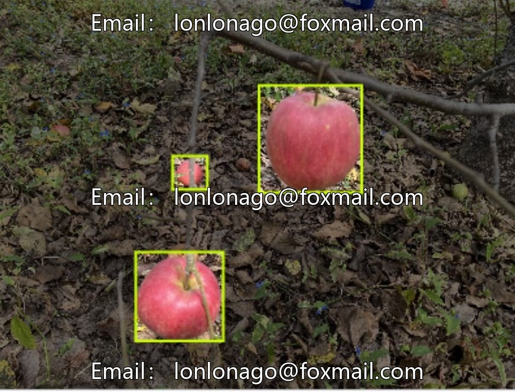
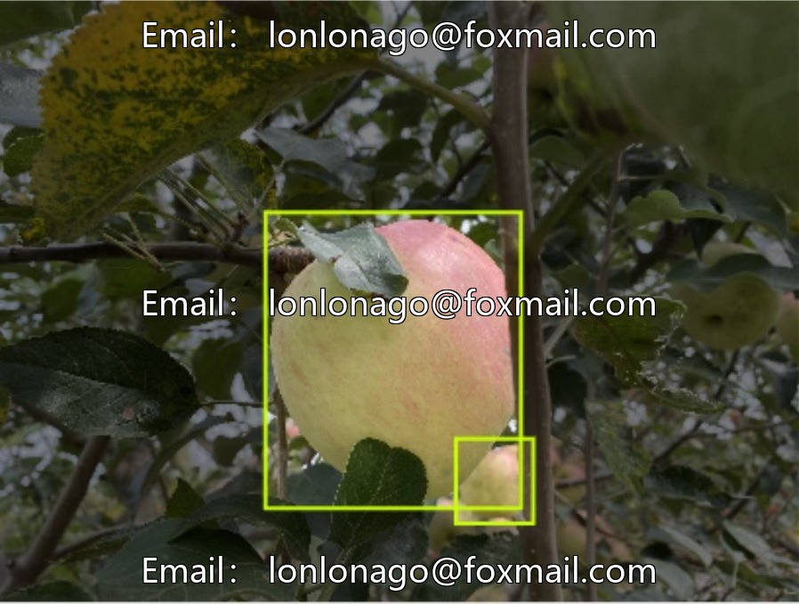
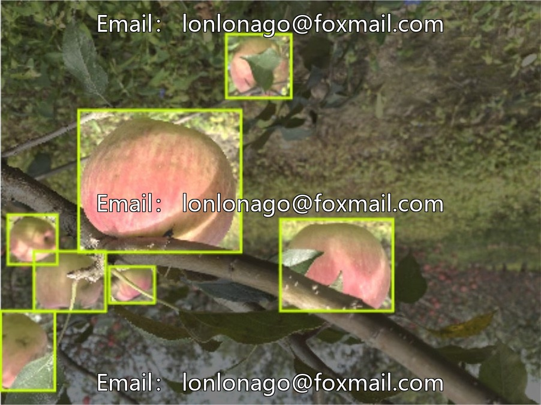
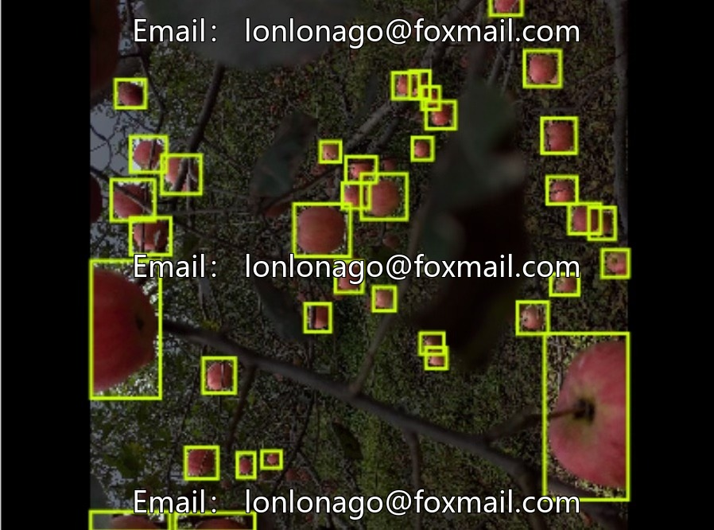
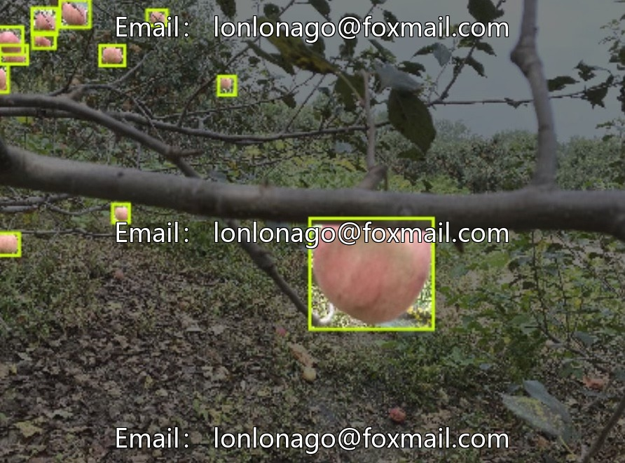
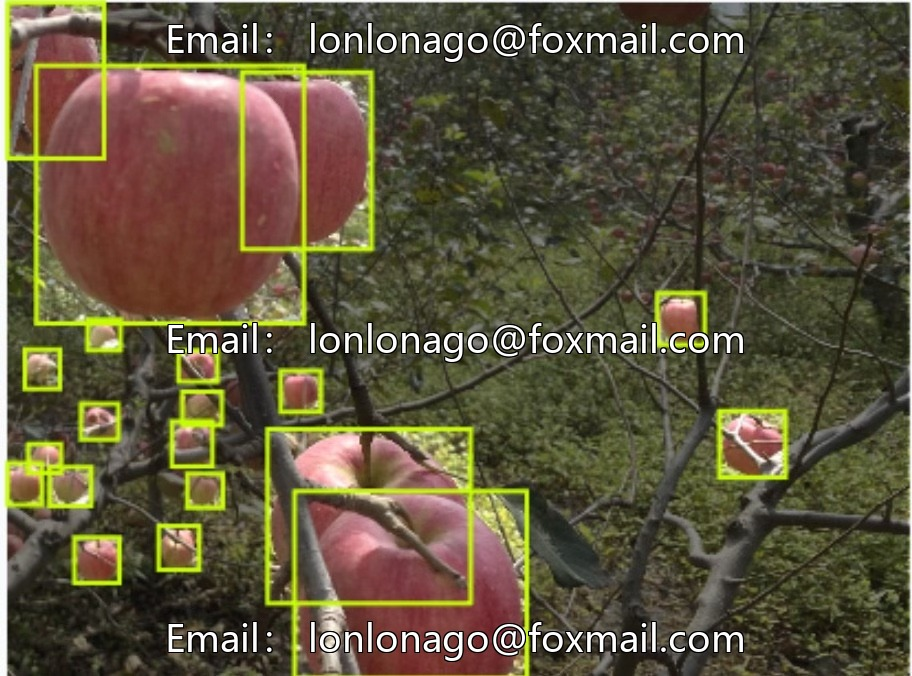

# Intelligent Agriculture Apple Picking Point Recognition Dataset, 7296 images, 1 dataset.

## Body

Intelligent Agriculture Apple Picking Point Recognition Dataset, 7296 images, 1 dataset, suitable for target detection tasks, supports training with models like Yolov11, can be directly used for model development and testing.

The dataset is target detection data in the field of computer vision, with clear images, distinct categories, and sufficient quantity, suitable for scientific research, algorithm optimization, model training, etc.

Virtual materials, once sold, are non-refundable.
Interested friends, click "I want" to proceed.

## Images

## Payment

Here is a pay link on Stripe ( https://buy.stripe.com/3cs8yP7sY87d0vu9AB ). Please contact me lonlonago@foxmail.com after funding $89, and I will send you a complete data files , thank you!

